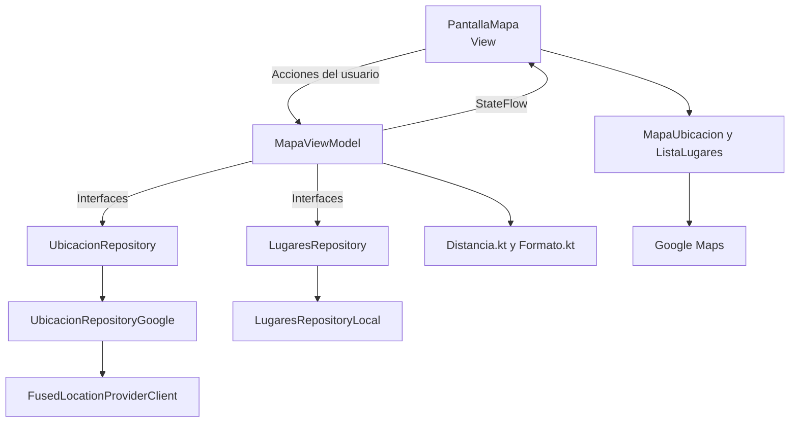

# CampusGPS

## Descripción

CampusGPS es una aplicación móvil desarrollada con Kotlin y Jetpack Compose que permite a los estudiantes encontrar diferentes puntos de interés dentro del campus de TECSUP.

La aplicación utiliza la ubicación del dispositivo para calcular las distancias hacia cinco lugares del campus, ordenarlos desde el más cercano hasta el más lejano y permitir la navegación visual hacia cada uno mediante Google Maps.

## Tecnologías utilizadas

- Kotlin
- Jetpack Compose
- Material 3
- Google Maps SDK for Android
- Maps Compose
- Google Play Services Location
- Kotlin Coroutines
- StateFlow
- Arquitectura MVVM
- Patrón Repository

## Funcionalidades

- Solicitud de permisos de ubicación precisa y aproximada.
- Obtención de la ubicación actual del dispositivo.
- Visualización de Google Maps.
- Marcadores de los cinco lugares del campus.
- Cálculo de distancias en metros y kilómetros.
- Ordenamiento de lugares según su proximidad.
- Selección manual de lugares.
- Identificación del lugar más cercano.
- Navegación visual hacia el lugar más cercano.
- Manejo de errores de permisos, GPS y Google Play Services.

## Estructura del proyecto

```text
com.clemente.campusgps/
│
├── data/
│   ├── LugaresRepository.kt
│   ├── LugaresRepositoryLocal.kt
│   ├── UbicacionRepository.kt
│   └── UbicacionRepositoryGoogle.kt
│
├── model/
│   └── Modelos.kt
│
├── ui/
│   ├── ListaLugares.kt
│   ├── MapaUbicacion.kt
│   ├── MensajeError.kt
│   ├── PantallaMapa.kt
│   └── theme/
│
├── util/
│   ├── Distancia.kt
│   └── Formato.kt
│
├── viewmodel/
│   ├── CampusViewModelFactory.kt
│   └── MapaViewModel.kt
│
└── MainActivity.kt
```

## Arquitectura MVVM

La aplicación utiliza una arquitectura MVVM junto con el patrón Repository para separar la interfaz, la lógica de presentación y el acceso a los servicios de ubicación.



## Lugares del campus

La aplicación utiliza cinco puntos de interés:

| ID | Lugar | Categoría |
|---|---|---|
| 1 | Biblioteca Central | Estudio |
| 2 | Cafetería Campus | Comida |
| 3 | Laboratorio de Cómputo | Estudio |
| 4 | Auditorio Principal | Eventos |
| 5 | Estacionamiento Norte | Servicios |

## Capturas de pantalla

### 1. Solicitud de permisos


### 2. Mapa con ubicación actual


### 3. Marcadores de los lugares del campus


### 4. Lista de lugares ordenada por distancia


### 5. Manejo de errores


## Configuración del proyecto

Para ejecutar el proyecto es necesario configurar una clave de Google Maps Platform.

La clave debe guardarse en el archivo `local.properties`, utilizando la propiedad:

```properties
MAPS_API_KEY=TU_CLAVE_API
```

No se debe publicar este archivo en el repositorio de GitHub.

También es necesario habilitar Maps SDK for Android en Google Cloud y configurar las restricciones correspondientes para la aplicación.

## Preguntas para pensar

### 1. ¿Por qué FusedLocationProviderClient está dentro del Repository y no en el ViewModel?

Porque el Repository es responsable de gestionar el acceso a fuentes de datos externas, como los servicios de ubicación de Google.

De esta manera, el ViewModel no necesita conocer los detalles de implementación de Google Play Services ni recibir un Context. Solo se comunica con la interfaz UbicacionRepository.

Esto permite mantener una separación de responsabilidades y facilita las pruebas y el mantenimiento del código.

### 2. ¿Qué diferencia hay entre el permiso de ubicación y la clave de API de Maps? ¿Qué pasa si falta cada uno?

El permiso de ubicación autoriza a la aplicación a acceder a las coordenadas del dispositivo.

La clave API permite utilizar los servicios de Google Maps Platform, en este proyecto, Maps SDK for Android.

Si falta el permiso de ubicación, la aplicación no puede obtener la posición del usuario.

Si falta una clave API válida o está mal configurada, el mapa puede no cargar correctamente, aunque la obtención de ubicación puede seguir funcionando.

### 3. ¿Por qué la clave va en local.properties y no en el código? ¿Qué harías si se subiera a GitHub por error?

La clave API se guarda en local.properties para evitar incluirla directamente en los archivos fuente y reducir el riesgo de exponerla en un repositorio público.

Si se publicara accidentalmente, debería revocarla o reemplazarla desde Google Cloud, generar una nueva clave, restringirla y actualizar la configuración local del proyecto.

También revisaría el historial del repositorio para eliminar la exposición del secreto.

### 4. ¿Dónde calculas la distancia y por qué no en el Composable?

El cálculo se realiza mediante la función distanciaMetros() del paquete util, utilizando Location.distanceBetween().

El ViewModel coordina el cálculo y actualiza la lista de lugares mediante StateFlow.

No se calcula en un Composable porque la interfaz debe encargarse de representar los datos, no de ejecutar la lógica de negocio.

Esta separación mantiene la arquitectura MVVM y facilita la reutilización y las pruebas.

### 5. ¿Qué pasa con tu app si el usuario niega el permiso dos veces? ¿Cómo lo manejas?

Android puede dejar de mostrar automáticamente el cuadro de solicitud de permisos cuando el usuario ha rechazado repetidamente el acceso, dependiendo del historial de solicitudes y de la versión del sistema.

La aplicación debe seguir funcionando sin cerrarse y mostrar un mensaje indicando que necesita el permiso de ubicación.

CampusGPS proporciona el botón Abrir ajustes, que dirige al usuario a la configuración de la aplicación para que pueda conceder el permiso manualmente.

## Autor

Proyecto académico desarrollado con Kotlin y Jetpack Compose.
